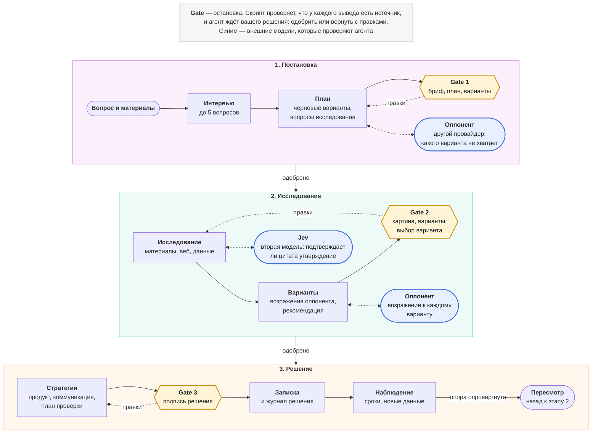
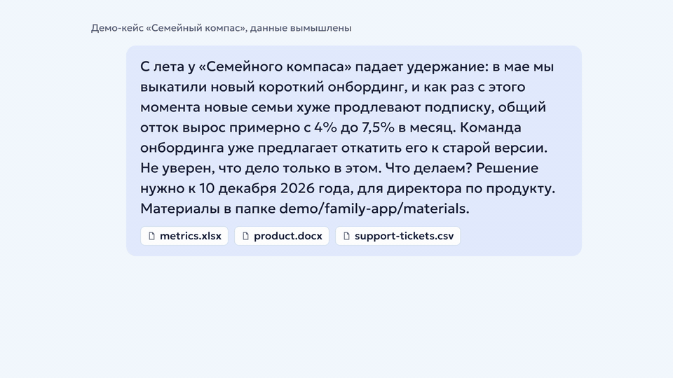

<div align="center">

# Стратег Фабрики продуктов

### ИИ-агент в вашей IDE, который превращает расплывчатый вопрос в решение с источниками.

**Каждая цифра открывает утверждение, источник и цитату.**


**[Живое демо](https://tlqqqqqi.github.io/product-strategist-agent/demo/replay/)** ·
[Демо-кейс](demo/family-app/request.md)

[Как это устроено](#как-это-устроено) · [Быстрый старт](#быстрый-старт) · [Этапы](#этапы) ·
[Ключи](#ключи) · [Устройство](#устройство)

`git clone https://github.com/tlqqqqqi/product-strategist-agent && bin/strat state`

</div>

Папка, которая превращает ИИ-агента в любом харнессе (Claude Code, OpenCode, Codex, Cursor и
другие) в стратегического аналитика для руководителя цифрового продукта. На входе расплывчатый
вопрос и материалы, на выходе решение: картина с источниками, не меньше трёх вариантов с
возражениями, продуктовая и коммуникационная стратегии, план проверки и записка на одну
страницу. После решения агент следит, не устарели ли факты, на которых оно держится.

Главное правило: каждая находка записывается как утверждение с источником, цитатой и типом
(факт, гипотеза, прогноз, допущение, пробел, вывод). Варианты и стратегии ссылаются только на
утверждения, и скрипт `bin/strat gate check` не пропускает строку без ссылки.

## Как это устроено



Суждения принимает агент по инструкциям в `skills/`. Скрипт `bin/strat` хранит состояние,
проверяет правила, вызывает внешние сервисы и считает стоимость. На каждой контрольной точке
агент останавливается и продолжает только после вашего «да».

## Как это выглядит



Демо-кейс «Семейный компас» (данные вымышлены): запрос, вопрос интервью, варианты на Gate 2,
карточка утверждения с цитатой из источника, итоговая записка. Прогоны целиком:
`demo/replay/index.html`.

## Зачем

- **Вывод можно проверить.** Каждая цифра в записке открывает утверждение, источник и цитату.
- **Факт отделён от догадки.** Гипотеза не становится опорой варианта без проверки.
- **Варианты спорят.** Модель другого провайдера пишет возражения, агент отвечает на каждое
  вердиктом со ссылкой.
- **Решение не устаревает молча.** Когда опорный факт опровергнут новыми данными, агент
  показывает, какие строки решения на нём держатся.

## Быстрый старт

1. Нужны Python 3.11+, git и любой харнесс с ИИ-агентом.
2. `git clone https://github.com/tlqqqqqi/product-strategist-agent.git && cd product-strategist-agent`
3. `bin/strat state`: первый запуск создаёт `.venv` (около минуты), ответ `no active case`
   значит, что всё готово.
4. Откройте папку в харнессе (например, `claude` или `opencode`).
5. Напишите задачу. Для демо-кейса скопируйте текст из `demo/family-app/request.md`.

Агент остановится трижды:

| Точка | Что вы видите | Что ответить |
|---|---|---|
| Gate 1 | бриф, черновые варианты, план исследования | «да» или правки |
| Gate 2 | картина с цитатами, варианты, возражения, рекомендация | номер варианта и «да» |
| Gate 3 | стратегии и план проверки | «подписываю» или правки |

Работу можно прервать в любой момент и продолжить в новом чате, в том числе в другом
харнессе: агент читает состояние кейса и не повторяет записанные шаги.

## Этапы

| Этап | Навык | Что получаете | Что проверяет скрипт |
|---|---|---|---|
| Интервью | `intake` | бриф | не больше 5 вопросов, по одному |
| План | `plan` | 3+ варианта, таблица решения, вопросы исследования | 4+ вопроса из веба по 3+ темам |
| Исследование | `research`, `materials`, `data-analysis` | утверждения с цитатами | на каждый веб-вопрос 4+ поиска двух видов и 4+ сохранённые страницы; 8+ фактов с 5+ сайтов; цитата есть в источнике; расчёты воспроизводятся |
| Варианты | `options`, `challenge` | 4+ варианта, возражения, рекомендация | у каждого возражения вердикт; отклонение ссылается на утверждение |
| Стратегии | `strategy`, `signoff` | продукт, коммуникация, план проверки | каждая строка ссылается на утверждение; серьёзное возражение к выбранному варианту снято или риск принят вашими словами |
| Записка | `report` | `memo.html` | каждая цифра совпадает с утверждением |
| После решения | `review`, `revise` | что пора проверить, что устарело | на какие строки влияет изменённый факт |

По ходу работы: интервью с пользователями (`interview`), аудио и видео (`media`), снимки
экрана публичных страниц (`ux-capture`).

## Что проверяет скрипт, а не модель

- **Ваше «да».** Хук харнесса записывает ваши сообщения, и подтвердить контрольную точку можно
  только после вашего согласия. «Продолжай» и «не утверждаю» согласием не считаются. Принятый
  риск цитирует ваши слова.
- **Печать.** Файлы кейса (утверждения, возражения, журнал, источники) меняются только через
  `bin/strat`; правка вручную не проходит проверку точки.
- **Ширина исследования.** Пороги поисков, страниц, сайтов и вариантов из таблицы выше.

## Ключи

Агентом может быть модель любого провайдера в любом харнессе. Ключи не обязательны: без них
агент ищет страницы встроенным веб-поиском харнесса, сохраняет каждую через `bin/strat read`
(ключ не нужен) и все суждения делает сам.

Ключи добавляют то, чего у одной модели нет:

| Ключ | Что добавляет | Зачем |
|---|---|---|
| `EXA_API_KEY` ([exa.ai](https://exa.ai)), или `TAVILY_API_KEY`, или `BRAVE_API_KEY` | `bin/strat search`: смысловой и точный поиск, список результатов сохраняется | поиск по смыслу находит страницы по теме вопроса, а не по совпадению слов; Gate 2 проверяет, что исследование было широким |
| `ANYMODEL_API_KEY` ([anymodel.org](https://anymodel.org)) | оппонент другого провайдера, проверка цитат моделью Jev, модельные респонденты | модель другого провайдера не разделяет слепые пятна агента; цитату проверяет не тот, кто её выбрал |
| `STRAT_STT_API_KEY` ([Mistral](https://console.mistral.ai)) | расшифровка аудио и видео | без ключа работает локальный Whisper |

### Как добавить ключи

1. `bin/strat setup` создаёт `.env` из `.env.example` и показывает, какие ключи пустые.
2. Откройте `.env` в редакторе и впишите ключ после `=`, без кавычек и пробелов:
   ```
   EXA_API_KEY=ваш-ключ
   ANYMODEL_API_KEY=ваш-ключ
   ```
   Остальные строки можно оставить пустыми.
3. `bin/strat doctor` покажет, что подключилось. Перезапускать агента не нужно: скрипт читает
   `.env` при каждом вызове.

Ключ вписывайте только в `.env`, не в чат с агентом.

## Стоимость, повтор, тесты

- `bin/strat cost`: время и деньги по этапам, вызовы скрипта и расход модели.
- `bin/strat replay export`: страница в виде чата, которая проигрывает прогон из журналов
  харнесса (пример: `demo/replay/index.html`).
- `.venv/bin/python -m pytest -q`: тесты без сети и ключей.

## Устройство

- `AGENTS.md` — вход для агента; `skills/` — инструкции по этапам; `knowledge/` — методика и
  шаблоны документов.
- `bin/strat`, `strat/` — скрипт: состояние, правила, внешние сервисы, стоимость.
- `hooks/` и файлы `.claude/`, `.opencode/`, `.cursor/`, `.qwen/`, `.gemini/`, `.gigacode/`,
  `.github/hooks/` — подключение к харнессам.
- `agents/` — оппонент и модельный респондент.
- `cases/<кейс>/` — материалы, источники, утверждения, документы и журнал одного решения
  (в git не попадают).
